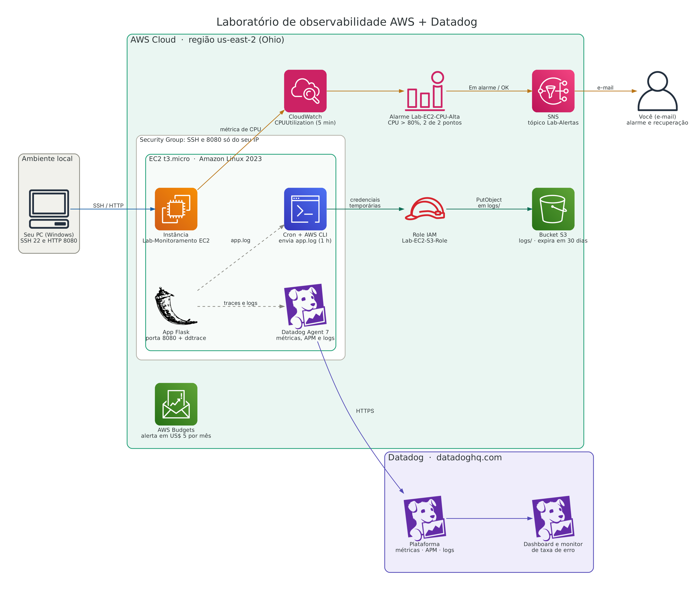
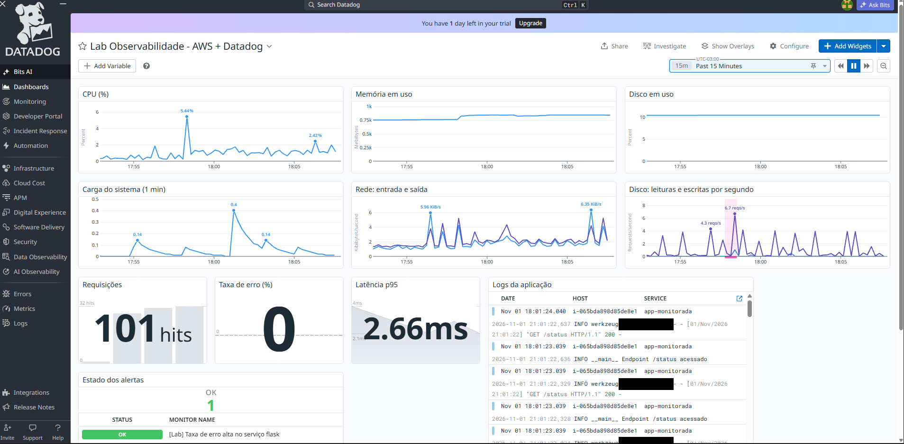
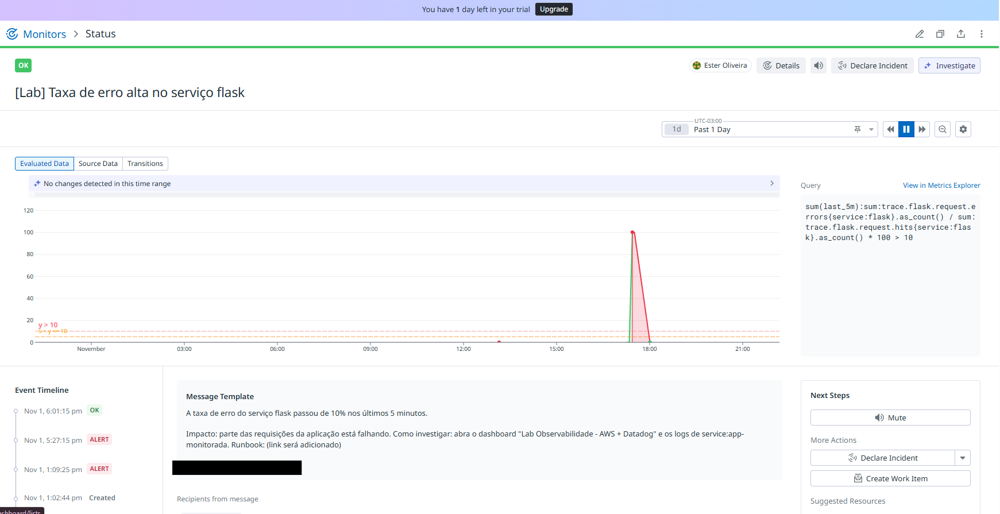
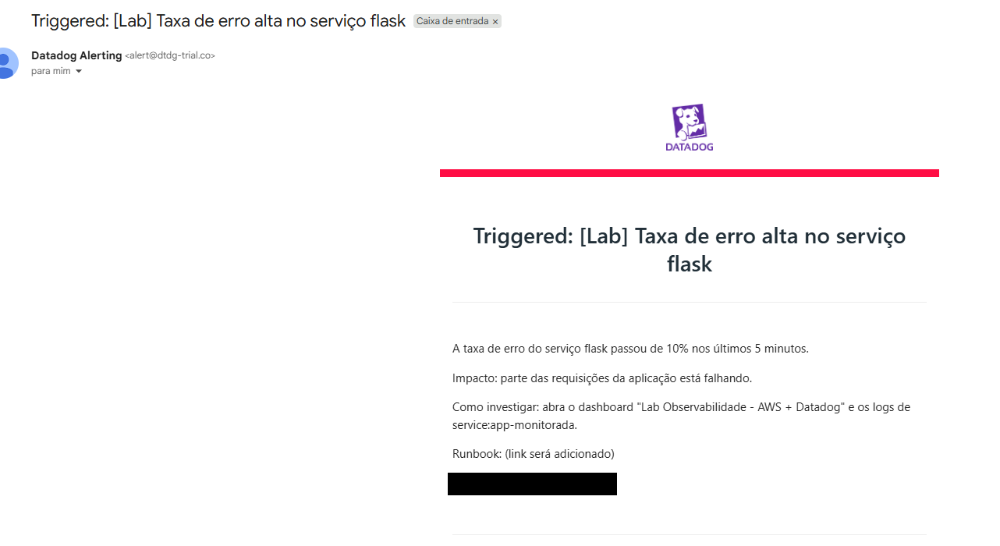
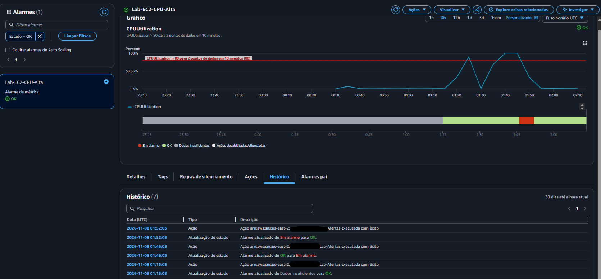
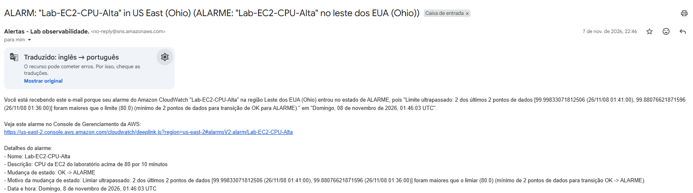
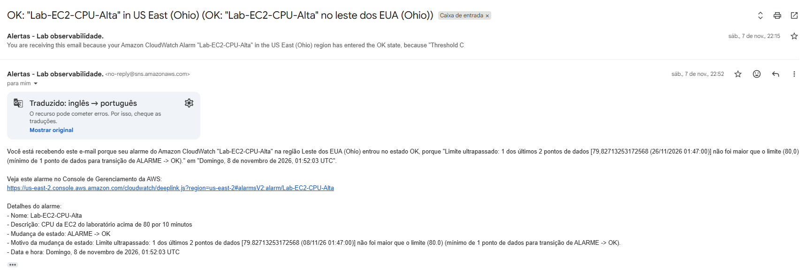
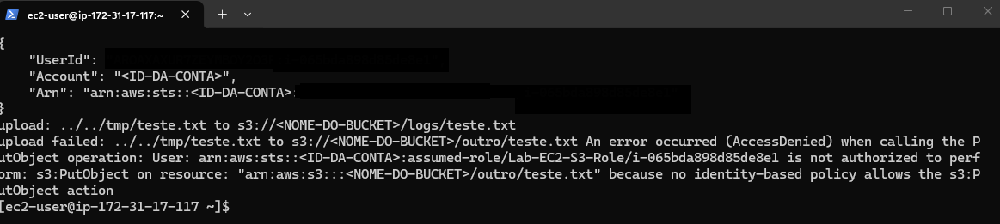

# Lab de Observabilidade em Cloud — AWS + Datadog


Ambiente de observabilidade montado do zero na AWS. Uma API Flask roda em uma instância EC2 e é monitorada por duas frentes: o alarme nativo do CloudWatch, com notificação por e-mail via SNS, e o Datadog, com métricas, traces, logs e monitor. Os logs também são enviados a um bucket S3, acessado pela EC2 com uma role do IAM de menor privilégio.

> Projeto de estudo, não um ambiente de produção: uma instância, sem balanceador, criado pelo console. A seção [Limitações e próximos passos](#limitações-e-próximos-passos) diz o que mudaria em produção.

## Topologia



## Stack

| Serviço | Função | Detalhe |
| --- | --- | --- |
| EC2 | Hospeda a aplicação e o agente | t3.micro, us-east-2 |
| Security Group | Firewall da instância | SSH 22 e HTTP 8080 só para o meu IP |
| App Flask | API de teste: `/`, `/status`, `/lenta`, `/erro` | Porta 8080 |
| Datadog Agent 7 + ddtrace | Métricas, traces (APM) e logs | Logs lidos do `app.log` |
| S3 | Cópia dos logs | Acesso público bloqueado, versionamento, SSE-S3, expira em 30 dias |
| IAM (role + política) | Acesso da EC2 ao S3 sem chaves | Só a pasta `logs/` do bucket |
| IAM (MFA e usuário de leitura) | Separação entre administrador e leitura | MFA no root, no administrador e no `Lab-leitura` |
| CloudWatch | Alarme de CPU | `Lab-EC2-CPU-Alta` |
| SNS | Notificação por e-mail | Tópico `Lab-Alertas` |
| AWS Budgets | Alerta de custo | US$ 5 por mês |
| Datadog | Dashboard e monitor | 11 widgets, monitor de taxa de erro |

## Ambiente

| Máquina | Tipo | Sistema | Função |
| --- | --- | --- | --- |
| Servidor | EC2 t3.micro (us-east-2) | Amazon Linux 2023 | API Flask + Datadog Agent 7 |
| Meu PC | Computador pessoal | Windows (PowerShell + SSH) | Acesso e administração |

## Como subir

Resumo do que foi feito, pelo console da AWS e por SSH:

1. **EC2:** Amazon Linux 2023, t3.micro, Security Group com SSH (22) e 8080 liberados só para o meu IP.
2. **Aplicação**, dentro da EC2:

```bash
pip3 install flask ddtrace --user
cd ~/app-monitorada
DD_SERVICE="app-monitorada" DD_ENV="lab" DD_VERSION="1.0" ddtrace-run python3 app.py
```

3. **Datadog Agent 7:** instalado com o comando do painel do Datadog. Em `/etc/datadog-agent/datadog.yaml`, ativar `logs_enabled: true` e `apm_config:` com `enabled: true` (2 espaços de indentação). Criar `/etc/datadog-agent/conf.d/python.d/conf.yaml` apontando para o `app.log`, com `service: app-monitorada` e `source: python`. Depois, `chmod o+x /home/ec2-user` e `sudo systemctl restart datadog-agent`.
4. **S3 e IAM:** bucket com acesso público bloqueado, versionamento, SSE-S3 e regra de ciclo de vida de 30 dias. Política `Lab-EC2-S3-Logs` e role `Lab-EC2-S3-Role`, anexada à instância.
5. **Envio dos logs:** `cronie` instalado e uma linha no cron.
6. **Alerta:** tópico SNS `Lab-Alertas` com assinatura por e-mail e alarme `Lab-EC2-CPU-Alta` no CloudWatch.

<details>
<summary>Política do IAM (<code>Lab-EC2-S3-Logs</code>)</summary>

```json
{
  "Version": "2012-10-17",
  "Statement": [
    {
      "Effect": "Allow",
      "Action": ["s3:PutObject", "s3:GetObject"],
      "Resource": "arn:aws:s3:::NOME-DO-BUCKET/logs/*"
    },
    {
      "Effect": "Allow",
      "Action": "s3:ListBucket",
      "Resource": "arn:aws:s3:::NOME-DO-BUCKET",
      "Condition": { "StringLike": { "s3:prefix": ["logs/*"] } }
    }
  ]
}
```

A role tem relação de confiança com `ec2.amazonaws.com` e só essa política anexada.

</details>

<details>
<summary>Cron de envio dos logs (a cada hora)</summary>

```
0 * * * * /usr/bin/aws s3 cp /home/ec2-user/app-monitorada/app.log s3://NOME-DO-BUCKET/logs/app-$(date +\%F-\%H00).log --region us-east-2
```

</details>

## Alertas configurados

- **Lab-EC2-CPU-Alta** (CloudWatch) — média de CPU acima de 80% em 2 períodos seguidos de 5 minutos (cerca de 10 minutos). Dados ausentes contam como "bom", porque a instância é desligada entre os estudos.
- **[Lab] Taxa de erro alta no serviço flask** (Datadog) — taxa de erro acima de 10% nos últimos 5 minutos. A mensagem traz o impacto, como investigar e o destinatário.
- O Datadog também listou 7 monitors de host e 2 de APM, de pacotes recomendados.
- Notificações por e-mail (SNS e Datadog).

## Evidências

### Dashboard no Datadog



Dashboard "Lab Observabilidade - AWS + Datadog", com 11 widgets: infraestrutura do host (CPU, memória, disco, carga, rede e I/O de disco), aplicação (requisições, taxa de erro e latência p95), logs da aplicação e estado dos alertas.

### Monitor de taxa de erro (Datadog)



Monitor `[Lab] Taxa de erro alta no serviço flask`: dispara quando a taxa de erro passa de 10% nos últimos 5 minutos. Disparou durante os testes e voltou a OK.

### E-mail do alerta (Datadog)



A mensagem traz o impacto, como investigar e o destinatário.

### Histórico do alarme de CPU (CloudWatch)



Incidente simulado: o alarme `Lab-EC2-CPU-Alta` foi de OK para Em alarme às 01:46:03 UTC e voltou para OK às 01:52:03 UTC.

### E-mail de alerta (CloudWatch)



Notificação enviada pelo SNS quando o alarme entrou em estado de alarme.

### E-mail de recuperação (CloudWatch)



Notificação enviada pelo SNS quando o alarme voltou para OK.

### Role do IAM com menor privilégio



Teste feito a partir da EC2 (ID da conta e nome do bucket substituídos): a role funciona, grava em `logs/` e recebe `AccessDenied` em qualquer outra pasta.

### Usuário de leitura com MFA (Lab-leitura)


Usuário `Lab-leitura`, em um grupo com a política `ReadOnlyAccess`, com acesso ao console "Habilitado com MFA" e um dispositivo virtual atribuído (ID da conta coberto).

### Lab-leitura: iniciar a EC2 é negado


O usuário enxerga a instância, mas a ação `ec2:StartInstances` é negada por falta de política que a permita.

### Lab-leitura: criar bucket no S3 é negado


A criação do bucket falha porque a permissão `s3:CreateBucket` é necessária. O acesso de leitura não altera nada.

## Incidente simulado

Para validar o fluxo completo, gerei carga na CPU da EC2 com `stress-ng --cpu 2 --timeout 900s` (duas vCPUs a 100% por 15 minutos).

| Horário (UTC) | Evento | Fonte |
| --- | --- | --- |
| ~01:36 | Início da carga | Estimado pelo `top` e coerente com o primeiro ponto do alarme |
| **01:46:03** | OK → Em alarme (e-mail de alerta) | Histórico do alarme |
| ~01:51 | Fim da carga | Estimado (início + 900 s) |
| **01:52:03** | Em alarme → OK (e-mail de recuperação) | Histórico do alarme |

- **MTTD ≈ 10 minutos.** É coerente com a regra: 2 períodos de 5 minutos, na resolução do monitoramento básico.
- **MTTR ≈ 1 minuto**, valor otimista: com a regra 2 de 2, basta um período abaixo de 80% para voltar a OK. A recuperação veio de um período com média de 79,8%, muito perto do limite, porque o fim da carga caiu no meio dele.
- Um pico anterior, de um único período acima de 80%, não disparou o alarme, como previsto pela regra.
- O início da carga é uma estimativa. Os horários do alarme são exatos.

Detalhes em [post-mortem do incidente](docs/post-mortem-cpu-alta.md) e no [runbook do alarme](runbooks/cpu-alta.md).

## CloudWatch x Datadog

| Critério | CloudWatch (nativo) | Datadog |
| --- | --- | --- |
| Resolução das métricas de EC2 | 5 minutos (monitoramento básico) | Coleta pelo Agent em intervalos menores |
| Tempo de detecção medido (MTTD) | ≈ 10 minutos | Não medido (o trial já havia encerrado) |
| Alertas configurados | Alarme de CPU, com e-mail via SNS | Monitor de taxa de erro, com e-mail, e monitors de host e APM |
| Memória e disco | Exigem o CloudWatch Agent | Incluídos no Agent |
| Traces de aplicação (APM) | Fora do escopo deste projeto | Sim, por endpoint |
| Logs com busca | Não configurado neste projeto | Sim, com Live Tail |
| Configuração | Simples, sem instalação para métricas básicas | Exige instalar e configurar o Agent |
| Custo | Dentro dos limites gratuitos neste laboratório | Cobrado à parte, com trial de 14 dias |

O CloudWatch resolve bem o alerta básico de infraestrutura sem instalar nada. O Datadog entrega mais visibilidade da aplicação (traces e logs correlacionados), ao custo de mais configuração e de um serviço pago à parte.

## Desafios Resolvidos

- Firewall da EC2 mostrava RDP — AMI do Windows selecionada por engano, trocada para Amazon Linux 2023
- EC2 Instance Connect falhava com o SSH restrito ao meu IP — resolvido com SSH local usando o arquivo `.pem`
- SSH com timeout depois de dias — o IP do provedor e o IP da EC2 mudaram; atualizei o Security Group e usei o IP atual
- Flask não subia nas portas 5000 e 5001 — usadas pelo Datadog Agent, aplicação movida para a 8080
- Porta 8080 ocupada após queda do SSH — processo antigo encontrado com `lsof` e encerrado
- APM não habilitava — indentação errada no YAML (`enabled: true` com 2 espaços sob `apm_config:`)
- `logs_enabled` não mudava — eu editava a linha de comentário (`##`); corrigi a linha certa e confirmei com `grep`
- Só os erros apareciam nos logs — o `dd-agent` não atravessava `/home/ec2-user`, resolvido com `chmod o+x`
- Descrição do IAM com "caracteres inválidos" — o campo não aceita acentos nem barra
- Role criada com o caso de uso do Systems Manager, que trava a política — voltei à etapa 1 e escolhi o caso de uso EC2
- Política anexada como "limite de permissões" — reanexada como política de permissões
- Alarme com `OKActions must not contain repeats` — duas notificações iguais para OK; separei "Em alarme" e "OK"
- `set-alarm-state` negado na EC2 — comportamento esperado do menor privilégio; o comando roda no CloudShell com o usuário IAM
- Cron inexistente no Amazon Linux 2023 — instalei o `cronie`; o `%` no cron precisa de `\%`
- Alarme não disparou no primeiro pico — a regra exige 2 períodos seguidos; mantive a carga por 15 minutos

## Segurança e custos

- **MFA** no usuário root e no usuário IAM administrador; a conta root não é usada no dia a dia.
- Usuário `Lab-leitura`, em um grupo com `ReadOnlyAccess` e MFA próprio. Testado: consegue visualizar os recursos, e iniciar a EC2 ou criar um bucket é negado.
- A role da EC2 só acessa a pasta `logs/` do bucket, com teste negativo. Nenhuma chave de acesso fica na instância.
- Acesso público ao bucket bloqueado, com versionamento e criptografia ativados.
- A API Key do Datadog e o arquivo `.pem` não estão no repositório (veja `.gitignore`). IDs de conta e IPs foram removidos dos prints.
- Conta no plano Free da AWS (créditos e prazo limitado), com alerta de custo em US$ 5 por mês. A EC2 é interrompida ao fim de cada sessão.
- O Datadog é cobrado à parte, com trial de 14 dias.

## Limitações e próximos passos

Limitações deste laboratório:

- Uma instância só, sem alta disponibilidade, criada pelo console.
- O usuário IAM do dia a dia (`Ester-admin`) tem permissão de administrador. Está mitigado com MFA e com um usuário de leitura separado, mas em produção eu usaria perfis por função.
- A aplicação roda com `debug=True`, protegida só pelo Security Group. Em produção, usaria um servidor WSGI (como o gunicorn) com o debug desligado.
- A API Key do Datadog fica em arquivo de configuração.
- O nome do serviço diverge: os traces aparecem como `flask` e os logs como `app-monitorada`. A causa não foi confirmada.
- CloudWatch básico, com resolução de 5 minutos e sem métrica de memória nativa.

Próximos passos:

- Recriar tudo com **Terraform**, para ser reprodutível.
- **Secrets Manager** para a API Key do Datadog e **IAM Identity Center (SSO)** no lugar de usuários com senha.
- **CloudWatch Agent** para memória e disco, e alarmes de `StatusCheckFailed` e de créditos de CPU.
- VPC própria com sub-redes, em vez da VPC padrão.
- Monitors de CPU e de latência no Datadog, para comparar o tempo de detecção com o do CloudWatch (o trial encerrou antes do teste de CPU).

## Estrutura do repositório

```
.
├── README.md
├── .gitignore
├── app/
│   └── app.py
├── docs/
│   ├── gerar_topologia.py
│   ├── post-mortem-cpu-alta.md
│   └── img/
└── runbooks/
    └── cpu-alta.md
```

## Sobre o projeto

Vim de uma rotina de operação e monitoramento (NOC), em que o trabalho é reagir a alertas. Este laboratório me fez construir o outro lado: a cadeia que gera o alerta, desde a métrica, passando pelo alarme e a notificação, até a medição do tempo de detecção. O [laboratório on-premise](https://github.com/Oliveira97-png/lab-observabilidade) (Prometheus, Grafana, Loki e Alertmanager) leva as mesmas ideias para VMs, e este projeto as leva para a nuvem.
